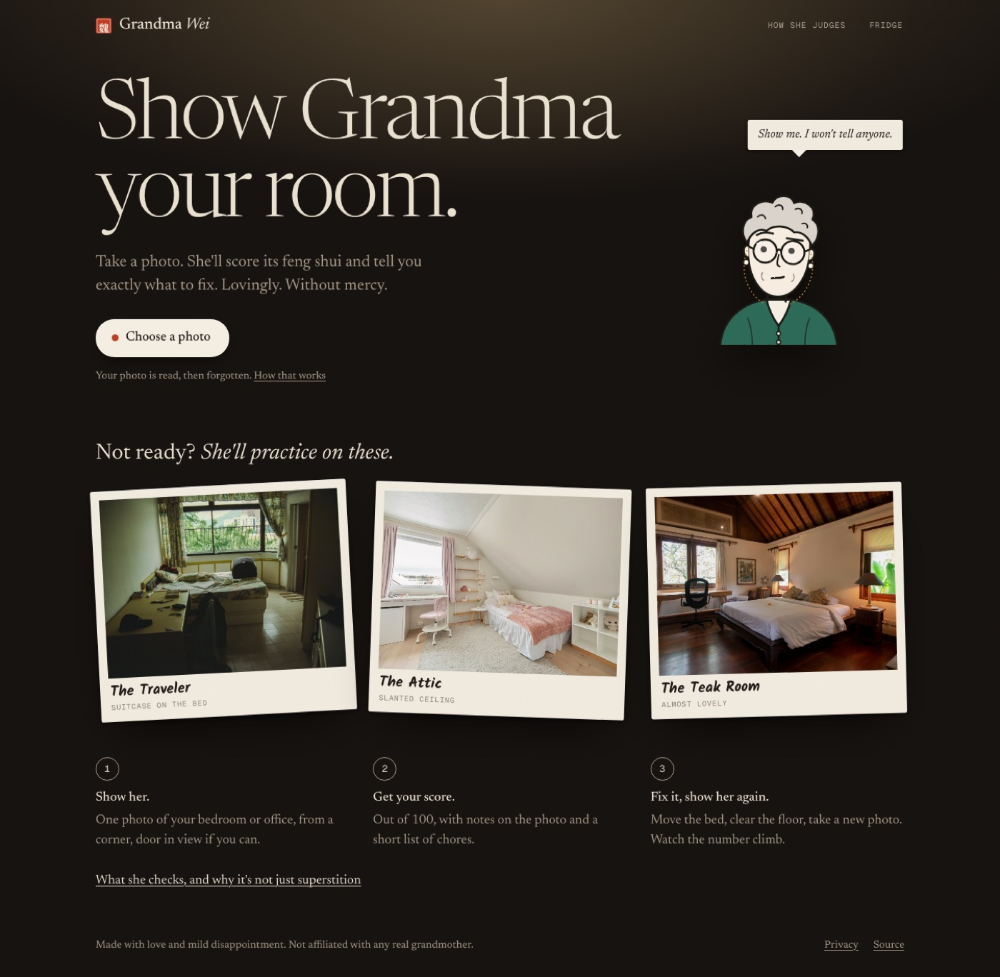
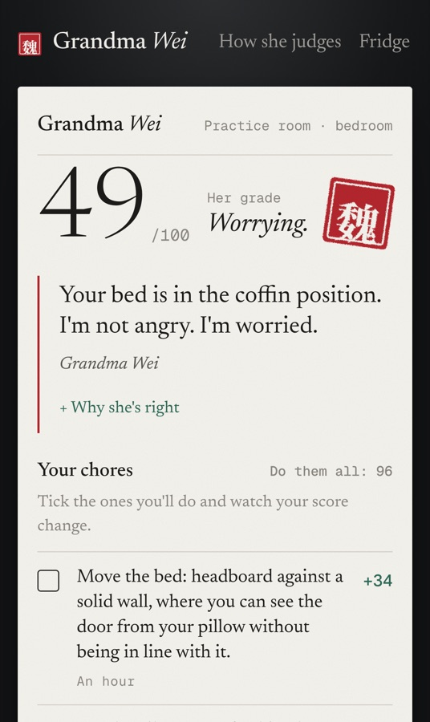
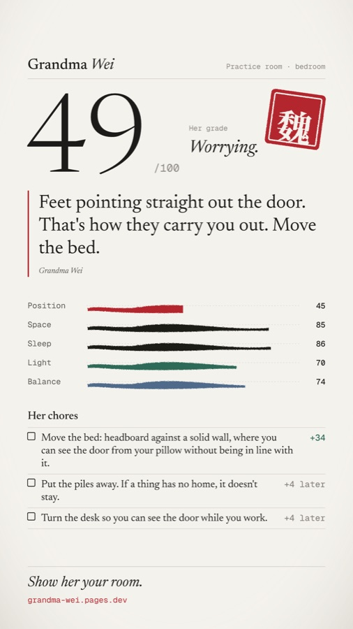
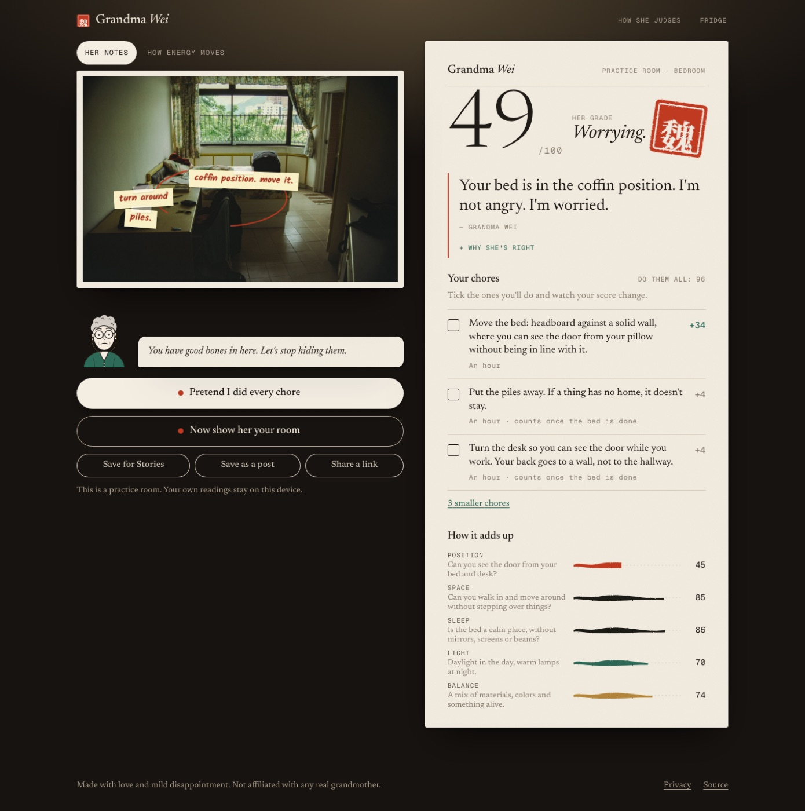
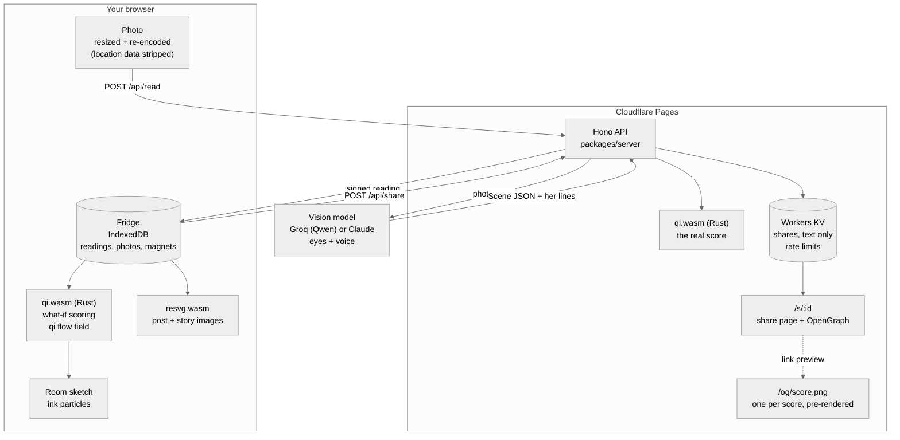
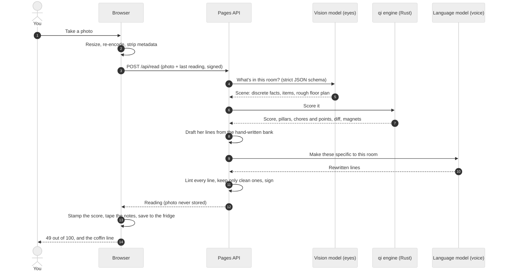
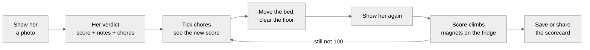

# Grandma Wei

**Take a photo of your room. Grandma Wei reads its feng shui, scores it, and tells you, lovingly but without mercy, what to fix.**

**Live at [grandma-wei.pages.dev](https://grandma-wei.pages.dev)** · [](https://github.com/KarthikSubramanian07/Grandma-Wei/actions/workflows/ci.yml)

`feng-shui` · `rust` · `webassembly` · `groq` · `claude` · `cloudflare-pages` · `bun` · `react` · `game`



Everyone has a grandmother who walks into your place and immediately starts moving things. This is her. She's warm, opinionated, a little disappointed in you, and always right. You show her your room; she stamps a score on it, tapes notes to the offending furniture, and hands you a short list of chores. Then you move the bed, take another photo, and watch the number climb.

> "Your bed is in the coffin position. I'm not angry. I'm worried."

## How it plays

1. **Show her.** One photo of your bedroom or office. On a phone the button opens the camera.
2. **Get her verdict.** A score out of 100, her grade, a headline worth screenshotting, notes on the photo, and the top three chores with exactly how many points each is worth.
3. **Imagine it.** Tick a chore and she re-scores the room on the spot. Flip to *How energy moves* and watch ink particles flow from the door through a sketch of your room, getting stuck where the clutter is.
4. **Fix it and show her again.** The retake shows the change, her reaction, and the magnets you earned for the fridge, with a before-and-after slider.
5. **Share it.** Save a post or story image, or send a link that unfurls with her verdict. Shares never include your photo.

No photo handy? Three practice rooms work with no setup at all.

<p align="center">
  
  
</p>



## Her personality, and her limits

- **The humor is about your room, never about her culture.** No accents, no fortune cookies, no "ancient secrets". She talks like your sharpest relative. A linter in `packages/voice` rejects stereotypes, accent spellings, insults about people, profanity, and invented numbers, and every hand-written line in the bank passes it in CI.
- **The advice is real.** She uses the practical side of feng shui, each rule paired with the everyday reason it helps: seeing the door from bed (designers call it prospect and refuge), screens away from the pillow, daylight, a clear way in.
- **She won't guess.** If she can't see your door, the door rules are left out of the score and she asks for a better angle.
- **She skips what a photo can't know.** No compass directions, no birth years.

## Privacy

- Your browser resizes the photo and re-encodes it, which strips location and camera data, before anything is sent.
- The server passes it to the vision model once (Groq on the live site, or Claude), never stores it, and never logs request bodies.
- Your readings, photos and magnets live in your browser (IndexedDB) and nowhere else.
- Shared links contain the scorecard text only and are deleted when you delete the reading.
- Rate limits use a salted hash, never an IP address.

## Architecture



### One reading, step by step



### The loop



**Why the score is fair.** The model only *describes* the room, in fixed categories ("the bed is in line with the door", "the floor has some clutter"). A deterministic Rust engine turns that description into the score. The same room always gets the same number, moving the bed changes it for a reason you can see, and chore points are computed by re-scoring, so `49 + 34` really is `83`. Deal-breakers cap the score: a bed in the coffin position holds a room at 49 until it moves.

| Path | What's there |
| --- | --- |
| `crates/qi` | The rules engine in Rust, compiled to WebAssembly: 18 rules over five pillars, deal-breaker caps, chores and their points, before/after diffs and magnets, a Laplace-solved qi flow field, and a solver that suggests where the bed should go |
| `packages/schema` | The room description schema (Zod), which doubles as the model's strict structured-output schema, and the engine's types |
| `packages/voice` | Grandma's hand-written lines, the personalization prompt, and the voice linter |
| `packages/server` | The API: vision (Groq or Claude), scoring, voice, signing, shares, rate limits, share-page tags |
| `packages/card` | One SVG template for the post, story and link-preview images, wrapped with real font metrics and rendered by resvg |
| `apps/web` | The site, Pages Functions, storage config (KV, or D1 via `migrations/`), and the end-to-end tests |
| `fixtures/rooms` | The practice rooms: Unsplash photos with hand-written scenes |
| `scripts` | The font pipeline and the link-preview pre-renderer |

## For agents and crawlers

- Every public page (`/`, `/how`, `/privacy`, `/about`, `/contact`) has its full text in the raw HTML, and answers `Accept: text/markdown` with Markdown (`Vary: Accept`). Each is also at its `.md` URL.
- [`/llms.txt`](https://grandma-wei.pages.dev/llms.txt) says what Grandma Wei is for, when to send someone to her, and which JSON endpoints show how scoring works.
- Unknown paths return a real `404`, in Markdown when asked, pointing to `llms.txt` and the sitemap.
- The content lives in `packages/site`; `scripts/prerender.ts` writes it into the build, and `apps/web/functions/_middleware.ts` handles negotiation and status codes.

## Run it

You need [Bun](https://bun.sh), Rust with the `wasm32-unknown-unknown` target, and [wasm-pack](https://github.com/wasm-bindgen/wasm-pack).

```sh
bun install
bun run qi                                  # Rust → WebAssembly
bun run --cwd apps/web build                # link previews + site
cd apps/web
./node_modules/.bin/wrangler pages dev dist # http://localhost:8788
```

Practice rooms work right away. For real photo readings, put `GROQ_API_KEY=...` (or `ANTHROPIC_API_KEY=...`) in `apps/web/.dev.vars`.

## Test it

```sh
bun run test:rust                     # 38 engine tests
bun test packages                     # schema, voice, server, card
bun run typecheck
cd apps/web && ./node_modules/.bin/playwright test   # phone, tablet, desktop
```

The end-to-end suite runs the real site and functions with local KV storage and a test-only stand-in for Grandma's eyes, so the whole photo, retake and fridge loop is tested without an API key.

## Deploy

```sh
bun run deploy   # build, ship to grandma-wei.pages.dev, smoke-test the live site
```

It deploys from your machine with your Cloudflare login (`wrangler login` once), so there are no deploy tokens in GitHub. CI still tests every push. Shares and rate limits live in the Workers KV namespace named in `apps/web/wrangler.toml`. Secrets live on the Pages project:

| Secret | What it does |
| --- | --- |
| `GROQ_API_KEY` | Real photo readings with Qwen 3.8 27B on Groq (vision plus strict JSON output) |
| `ANTHROPIC_API_KEY` | Or Claude instead. If both are set, Claude wins unless `AI_PROVIDER=groq` |
| `SIGNING_SECRET` | Signs readings so retakes and shares can't be forged; the live project has one |

Without either API key the site runs practice rooms only. Set one with `apps/web/node_modules/.bin/wrangler pages secret put GROQ_API_KEY --project-name grandma-wei`.

## Credits

Practice room photos are from Unsplash ([credits](fixtures/rooms/CREDITS.md)). Fonts: Newsreader, Geist Mono and Kalam, all under the SIL Open Font License. Grandma's seal is the character 魏 (Wei), drawn from Noto Serif SC.

Not affiliated with any real grandmother. MIT licensed.
